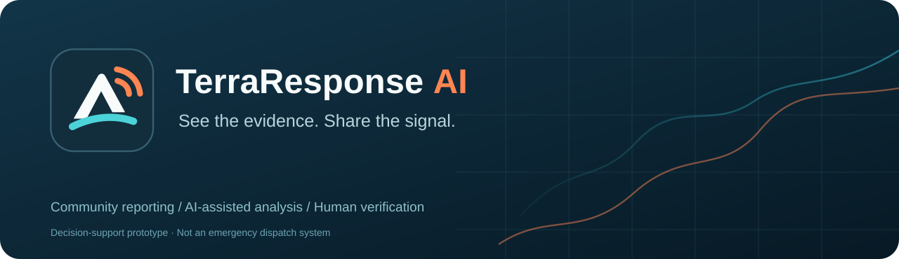
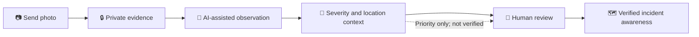

<p align="center">
  
</p>

<h1 align="center">TerraResponse AI</h1>
<p align="center"><strong>See the evidence. Share the signal.</strong><br />
Community-powered disaster photo reporting, AI-assisted observations and human verification.</p>

<p align="center">
  <a href="https://youtu.be/MldyTvwECMo"><strong>▶ Watch the 3-minute hackathon demo</strong></a> ·
  <a href="https://terra-response-ai.vercel.app/"><strong>Live application</strong></a> ·
  <a href="docs/HACKATHON_SHOWCASE.md"><strong>Meta AI feature showcase</strong></a> ·
  <a href="docs/HACKATHON_SUBMISSION_2026.md"><strong>Submission kit</strong></a>
</p>

> **Meta Global AI Developer Hackathon 2026 · Build for Your World.**
> TerraResponse AI is a **human-reviewed disaster photo intelligence prototype**.
> The [actual 3:00 demo video](https://youtu.be/MldyTvwECMo) shows report submission,
> an **AI-unavailable/manual-review fallback**, review controls, and map exploration.
> It does **not** establish that the recorded model call completed successfully,
> that every review button committed a real transaction, or that a photographed
> incident is authentic. This is **not** emergency dispatch or a public warning feed.

<p align="center">
  <a href="docs/DESIGN.md">Design system</a> ·
  <a href="docs/ARCHITECTURE.md">Architecture</a> ·
  <a href="docs/SECURITY.md">Safety and security</a> ·
  <a href="docs/DEPLOYMENT.md">Deployment guide</a>
</p>

> **Decision-support prototype — not an emergency alert or dispatch service.**
> AI classifications are provisional. A human review is required for a verified
> finding; an urgent review priority does not mean a public warning has been issued.

Built for the [Meta Global AI Developer Hackathon](https://dev.meta.ai/events/global-hackathon).

## Meta Hackathon 2026 — where Meta AI is used

| Meta capability | Actual implementation | Status / trust boundary |
| :-- | :-- | :-- |
| **Meta Muse Spark 1.3** · vision-language model | Receives a validated photo derivative through the Meta Model API `/v1/chat/completions`. Requests a structured incident category, visible evidence, preliminary severity, uncertainty, and summary. A separate Zod schema validates usable output. | **Integrated, but fallible.** An empty or invalid response is recorded as unavailable/manual-review; the video shows such a fallback. AI cannot confirm a disaster. |
| **Meta SAM 3.1** · image segmentation | Optional reviewer-requested text-target segmentation through `/v1/responses` using an actual image. The app decodes Meta's mask stream and only displays validated image-aligned masks. | **Optional and cost-bounded.** Requires `SAM_API_KEY` and an explicit target. Live paid SAM and photo-mask alignment have not been independently demonstrated in the uploaded video. |
| **Human-in-the-loop verification** · product workflow, **not a Meta AI model** | Separate reporter/reviewer roles, event-level permissions, private stored photos, explicit confirmation/correction/flag/rejection, and audited decisions. | Human decisions do not prove a photo's historical authenticity, GPS origin, or real-world incident severity. |
| **Geographic context** · app integration, **not a Meta AI model** | MapLibre geographic pinning, coordinates, optional MapTiler place-name lookup, report map, and review-status indicators. | Locations are user-supplied/confirmed, not automatically verified evidence. |

This entry **uses Muse Spark 1.3 and optional SAM 3.1**. Other models in the broader hackathon ecosystem (for example Muse Wonder, Muse Image, or Muse Voice Transcribe) **are not claimed as integrations**. No synthetic model output is passed off as a successful real inference.

### Meta features judges can inspect

- **Photo understanding:** Muse Spark receives a server-prepared image derivative and returns incident categories, visible evidence, provisional severity, confidence, uncertainty and a summary.
- **Structured observations:** JSON-schema-constrained requests and independent Zod validation keep malformed or incomplete responses out of successful analysis records.
- **Bilingual summaries:** The observation schema requests English and draft Tagalog summaries, which reviewers can inspect and correct.
- **Visual inspection:** SAM accepts a reviewer's concrete object target, decodes streamed segmentation output, and returns validated masks and bounding boxes for image overlays.
- **Traceable analysis:** Model, prompt and schema versions accompany successful observations; human review preserves the distinction between an AI suggestion and a review decision.
- **Resilient operation:** Timeouts, rate/budget limits and explicit unavailable/no-match outcomes keep reports usable for manual review when Meta services fail.
- **Private server integration:** Meta API credentials stay on the server; image derivatives are sent inline rather than exposing original storage URLs.

Optional Google/Gemini features in the repository provide contextual search, map alerts and audio transcription. These are separate from the Meta integrations and require their own configuration; they are not Meta model capabilities.

The complete [Meta feature and architecture explanation](docs/HACKATHON_SHOWCASE.md) includes the fallback pathway, privacy and safety boundaries, and a reproducible judging checklist.

## A simpler way to report

People do **not** need to predict a disaster, create an event, or choose a
workspace to share relevant evidence. Event organization happens behind the
scenes; incident threads remain suggestions until reviewed.



| Stage | What a person sees | What the system does |
| :-- | :-- | :-- |
| **Report** | Choose a photo, confirm or skip location, submit | Validates the file and saves private evidence |
| **Understand** | Track preliminary analysis and report status | Extracts safe derivatives and validates AI observations |
| **Verify** | Reviewer decision and provenance | Preserves uncertainty; authorized reviewers confirm, correct or reject |
| **Organize** | Incident threads and context map | Suggests related observations without silently merging evidence |

### Who can do what

| Role | Main experience |
| :-- | :-- |
| **Reporter** | Submit a photo with no event setup; track their authorized reports |
| **Reviewer** | See authorized review queues, check evidence and record decisions |
| **Administrator** | Reviewer capabilities plus role oversight, audit tools and privileged controls where enabled |

The platform never automatically dispatches emergency services, and it does not
treat model-generated severity as human-confirmed evidence.

### Brand and UI

The mark combines a **terrain peak**, a **shared observation horizon** and
**broadcast arcs**. It is deliberately calm, recognizable at favicon sizes,
and independent from report-verification symbols.

- **Day** — cool survey-paper surfaces and dark ink.
- **Mist** — a softer light palette designed for long reading sessions.
- **Night Ops** — dark field-operations palette with readable bright controls.
- **Auto** — follows the device color preference.

The vector icon (`public/logo.svg` and `src/app/icon.svg`) is infinitely
scalable, including 8K exports. The committed multi-resolution
`src/app/favicon.ico` contains practical browser sizes (16–256 px), not
a misleading 8192-pixel ICO. Typography uses **Bricolage Grotesque** for
headings and **Public Sans** for readable UI text. See
[the design guide](docs/DESIGN.md) for color contrast, tokens, responsive
behavior and accessible motion.

## Architecture

```
┌─────────────────────────────────────────────────────┐
│                    Browser (Client)                  │
│  Next.js App Router · React 19 · Tailwind · MapLibre │
└──────────────────────────┬──────────────────────────┘
                           │ HTTPS (cookies)
┌──────────────────────────▼──────────────────────────┐
│              Next.js 16 Server (Node.js)              │
│  Middleware (auth refresh) · Server Components        │
│  Route Handlers (API) · Server Actions (auth)        │
│  Sharp (image processing) · exifr (EXIF)             │
└──────┬─────────────┬──────────────┬───────────────────┘
       │             │              │
       ▼             ▼              ▼
┌──────────┐ ┌────────────┐ ┌────────────────┐
│ Supabase │ │ Meta API   │ │ Supabase       │
│ Auth     │ │ v1/chat/   │ │ Storage        │
│ (JWT)    │ │ completions│ │ (private       │
│          │ │ v1/responses│ │ buckets)       │
│ Postgres │ │            │ │                │
│ + RLS    │ │ Muse Spark │ │ Originals      │
│          │ │ 1.3        │ │ Derivatives    │
│ RLS data  │ │ SAM 3.1    │ │ Thumbnails     │
└──────────┘ └────────────┘ └────────────────┘
```

### Sequence: upload → analyze → review → map

```
Contributor                Server                 Muse Spark    Supabase
    │                         │                       │           │
    │── upload photo ────────►│                       │           │
    │                         │── validate file ──────►│           │
    │                         │── extract EXIF ───────►│           │
    │                         │── store private ──────►│           │
    │                         │── insert report ─────►│           │
    │                         │── chat/completions ──►│           │
    │                         │◄── structured JSON ───│           │
    │                         │── Zod validate ──────►│           │
    │                         │── insert analysis ───►│           │
    │◄── needs_review ───────│                       │           │
    │                         │                       │           │
    │                    Reviewer                     │           │
    │                         │── confirm/correct ───►│           │
    │                         │── insert review_act ─►│           │
    │                         │── update status ─────►│           │
    │◄── reviewed ────────────│                       │           │
    │                         │                       │           │
    │── view map ────────────►│                       │           │
    │◄── confirmed pins ─────│                       │           │
```

## Meta model integration

| Model | API endpoint | Why it's meaningful |
|---|---|---|
| **Muse Spark 1.3** (`muse-spark-1.3`) | `POST /v1/chat/completions` | Vision-language model that produces structured observations (incident type, severity, evidence, uncertainties, summaries) from disaster photos. Uses JSON-schema-constrained decoding (`response_format: { type: "json_schema", strict: true }`) to request structured output. A separate Zod validation layer rejects malformed or incompatible results; empty model responses are handled explicitly and never counted as validated findings. |
| **SAM 3.1** (`sam-3.1`) | `POST /v1/responses` | Media segmentation model that can produce image-segmentation masks for a concrete reviewer-provided target (e.g., "floodwater"). Uses the Responses API with streaming (`stream: true`). Opt-in — never runs automatically. If unavailable, the rest of the report is fully usable. |

Both models use the Meta Model API at `https://api.meta.ai/v1` with Bearer token auth.

## Setup

```bash
# 1. Clone + install
git clone https://github.com/Vaydelux/TerraResponseAI_Meta_Hackathon_2026.git
cd TerraResponseAI_Meta_Hackathon_2026
bun install --frozen-lockfile

# 2. Local configuration (do not commit credentials)
cp .env.example .env
# Fill in the matching Supabase project URL, anon key and server-only
# service-role key. MODEL_API_KEY is needed for real Muse Spark inference.

# 3. Run locally
bun run dev    # http://localhost:3000

# 4. Verification
bun run lint && bun run typecheck && bun run test && bun run build
```

**Database migration safety:** The existing production and staging projects have different migration histories. Do not run `supabase db push` against either without reconciling the remote migration ledger and verifying the target. Staging has source migrations 0001–0012 installed, including the reviewer RPC. The connector-generated remote migration versions still differ from the repository's four-digit names. Only the protected staging workflows create an ephemeral timestamp-aligned CLI workspace for safe staging previews/applications; never run a blind `db push` from the repository root. Distinct-role end-to-end tests remain outstanding. See [staging issue #30](https://github.com/Vaydelux/TerraResponseAI_Meta_Hackathon_2026/issues/30) and [the staging verification guide](docs/LIVE_STAGING_VERIFICATION.md).

See `docs/DEPLOYMENT.md` for the full Vercel + Supabase deployment guide, and [the hackathon submission kit](docs/HACKATHON_SUBMISSION_2026.md) for an evidence-based three-minute demo and release criteria.

## Environment variables

See `.env.example` for the full list. Key variables:

| Variable | Server-only? | Default | Purpose |
|---|---|---|---|
| `MODEL_API_KEY` | ✅ | (empty) | Meta Model API key |
| `SAM_API_KEY` | ✅ | (empty) | SAM 3.1 API key (optional) |
| `SUPABASE_SERVICE_ROLE_KEY` | ✅ | (empty) | Bypasses RLS — server only |
| `NEXT_PUBLIC_SUPABASE_URL` | ❌ | (empty) | Supabase project URL (public) |
| `NEXT_PUBLIC_SUPABASE_ANON_KEY` | ❌ | (empty) | Supabase anon key (public; RLS is the boundary) |
| `DEMO_MODE` | ✅ | (unset) | `1` = show "Demonstration Data" banner |

## Tests

```bash
bun run test          # Vitest unit + mocked integration tests
bun run test:e2e      # Playwright browser tests (requires the proper test environment)
bun run test:smoke    # Opt-in: paid/real Meta model API smoke tests (requires keys)
bun run typecheck     # TypeScript strict typecheck
bun run lint          # ESLint
bun run build         # Production build
```

## Safety limitations (fixed boundaries)

1. **No automatic dispatch** — no API client for any emergency service exists in the codebase.
2. **AI observations always labeled "AI-generated, not verified"** until a reviewer acts.
3. **Priority score is "provisional review prioritization"** — not for triage or resource allocation.
4. **No self-signup for reviewer/admin** — the first admin is bootstrapped via a server-side script.
5. **Evidence photos in private storage** — 60-second signed URLs, never publicly accessible.
6. **Retention workflow** — contributors/reviewers can request evidence deletion; storage purged after 7 days.
7. **Prompt-injection defenses** — prompts use constrained templates and validated inputs. The explicitly entered SAM object target is sent to Meta when a reviewer opts in; untrusted inputs are not assumed safe.
8. **Bounded API spend** — per-user, per-event, and daily ceilings prevent runaway costs.

## Demo data

The demo seed (`scripts/seed-demo.ts`) creates 5 rights-cleared demo reports with precomputed mock observations (`model_id = "demo-mock-v1"`, NOT `muse-spark-1.3`). When `DEMO_MODE=1`, a red "Demonstration Data" banner is visible on every page. The mock observations are clearly labeled — they are never falsely presented as live Meta inference.

See `docs/DEMO_SCRIPT.md` for the 3-minute demo script and `docs/DEMO_MODE.md` for the demo data details.

## Hackathon submission status

The repository includes a [3-minute demo](https://youtu.be/MldyTvwECMo), [live application](https://terra-response-ai.vercel.app/), [Meta feature showcase](docs/HACKATHON_SHOWCASE.md) and [submission kit](docs/HACKATHON_SUBMISSION_2026.md).

As checked on **November 5, 2026 (Asia/Singapore)**, GitHub issues [#21](https://github.com/Vaydelux/TerraResponseAI_Meta_Hackathon_2026/issues/21), [#23](https://github.com/Vaydelux/TerraResponseAI_Meta_Hackathon_2026/issues/23), [#30](https://github.com/Vaydelux/TerraResponseAI_Meta_Hackathon_2026/issues/30), [#42](https://github.com/Vaydelux/TerraResponseAI_Meta_Hackathon_2026/issues/42) and [#48](https://github.com/Vaydelux/TerraResponseAI_Meta_Hackathon_2026/issues/48) are **closed**. Their discussions remain historical engineering context. Issue closure alone does not establish live deployment acceptance: the recorded demo shows manual-review fallback, and successful live Muse inference, paid SAM overlays and separate-role end-to-end acceptance still need their own evidence.

## License

This project's owned code is released under the MIT License — see `LICENSE`.

## Contributors

- **Project creator** — product concept, architecture, development, testing and submission.

### AI-assisted development workflow

TerraResponse AI was built iteratively for **Meta Hackathon 2026**. The creator used **z.ai** for the initial design and build, **Gemini 4 and Gemini 3.8** for agent-first development, then **ChatGPT and Codex** for polishing and brainstorming. These are the creator's development-tool credits; they are separate from the models called by the deployed application.

The hackathon's Meta integrations are **Muse Spark 1.3** for photo understanding and **SAM 3.1** for optional object segmentation. The creator retains responsibility for product decisions, reviewing generated work, testing and submission.

## Documentation

- `docs/HACKATHON_SHOWCASE.md` — hackathon pitch, Meta Muse/SAM integration and video evidence
- `docs/HACKATHON_SUBMISSION_2026.md` — judge-facing submission kit and release caveats

- `docs/DESIGN.md` — brand consistency, Day/Mist/Night Ops tokens, responsive UI and contrast rules

- `docs/DEPLOYMENT.md` — Vercel + Supabase deployment guide
- `docs/DEMO_SCRIPT.md` — 3-minute demo script with timestamps
- `docs/DEMO_MODE.md` — demo data + live API evidence
- `docs/SECURITY.md` — security boundaries + RLS policies
- `docs/ARCHITECTURE.md` — system architecture + DB schema
- `docs/BUILD_PLAN.md` — phase-by-phase implementation plan
- `docs/PRODUCT_SCOPE.md` — scope + fixed safety boundaries
- `docs/DECISIONS.md` — architecture decision records
- `tests/TEST_COVERAGE.md` — test inventory + known limitations
